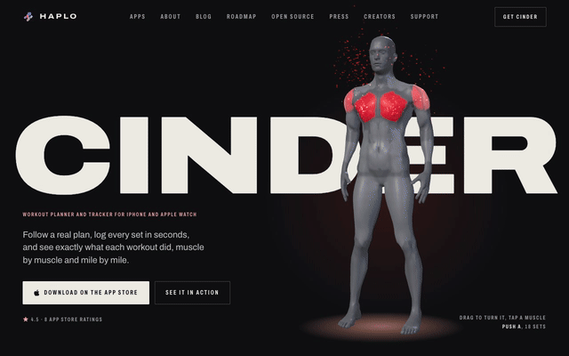
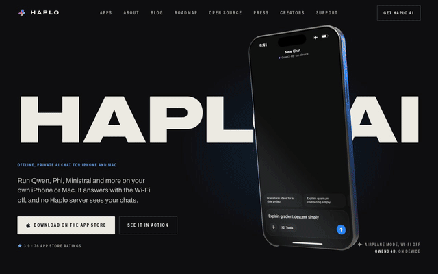
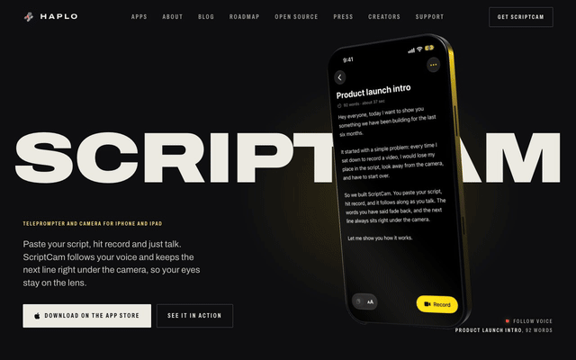
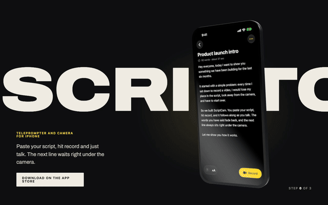

<div align="center">

# 3D Scroll Story

**The scroll-driven 3D product pages from [haploapp.com](https://haploapp.com), as a Claude skill and a working template.**

A 3D object pinned on stage while your story scrolls over it. Every step is a pose, and the scene flies, holds and changes screens between them. Native scrolling, one progress number, no timeline library, no build step.


</div>

<table>
  <tr>
    <td align="center" width="33%"><a href="https://haploapp.com/cinder"></a></td>
    <td align="center" width="33%"><a href="https://haploapp.com/haplo_ai"></a></td>
    <td align="center" width="33%"><a href="https://haploapp.com/scriptcam"></a></td>
  </tr>
  <tr>
    <td align="center"><b><a href="https://haploapp.com/cinder">Cinder</a></b><br><sub>The app's own body mesh. Each lift heats the muscles it works.</sub></td>
    <td align="center"><b><a href="https://haploapp.com/haplo_ai">Haplo AI</a></b><br><sub>A reply streams token by token, then an image diffuses step by step.</sub></td>
    <td align="center"><b><a href="https://haploapp.com/scriptcam">ScriptCam</a></b><br><sub>The teleprompter lights each word as you read, then takes stitch into one video.</sub></td>
  </tr>
</table>

## Use it with Claude

Install the skill, then ask for a 3D scroll story on any page.

```bash
git clone https://github.com/haplollc/3d-scroll-story ~/.claude/skills/3d-scroll-story
```

> *"Add a 3D scroll story to my app's landing page: an iPhone showing these three screenshots, one per section."*

Claude reads [`SKILL.md`](SKILL.md): the markup, the progress number, the pose sets for wide and tall screens, the damping, the framing trick, the phone and its screen shader, live canvas UI, fallbacks, and how to check it in a real browser.

## Try the template



```bash
cd template
python3 -m http.server 8000
# open http://localhost:8000
```

One HTML page, one stylesheet and three modules. To make it yours, change three things in [`story.js`](template/story.js):

- **`SCREENS`**: what the phone shows at each step.
- **`POSES`**: where the phone and camera sit for each beat, for wide and tall screens.
- **`KEYS`**: when each beat plays.

Three.js loads from a CDN through an import map, so there's nothing to install.

<br clear="right">

## How it works

| | |
|---|---|
| **The stage stays pinned** | The stage is `position: sticky` for the whole section, so it holds still while tall steps of copy scroll over it, then lets go when the section ends. |
| **Scroll becomes one number** | `storyProgress()` is 0 while the hero is up, then 1, 2, 3 as each step's top reaches 60% of the screen, fractional in between. |
| **Steps are poses** | A pose is ten numbers: object position and rotation, camera distance and aim. A pose listed twice in the timeline holds while its step is read; the gap between is the flight. |
| **Motion is damped** | The story eases after the scroll, and every pose number eases towards its target, frame-rate independent. |
| **The picture moves, not the camera** | `setViewOffset` puts the object beside the copy on wide screens and above it on phones. |
| **The screen is a shader** | Exact rounded corners at any zoom, a dim for screen changes, and a reflection that slides as the phone turns. Real screenshots or live UI drawn on a canvas. |
| **It degrades** | No WebGL shows a still image. Reduced motion snaps between poses. The loop sleeps when the section is off screen. |

## What's inside

```
SKILL.md            the method, for Claude (and for you)
template/
  index.html        the markup: stage, giant word, hero, steps
  story.css         sticky stage, steps, phone layout
  kit.js            progress, easing, render loop, textures, fallbacks
  phone.js          the 3D iPhone and its screen shader
  story.js          the scene: screens, poses, timeline
  screens/          three real ScriptCam screens
tools/
  capture.mjs       scroll a page's story in headless Chrome and save frames
  gif.sh            frames to an optimised GIF
```

Check a story the way a visitor sees it, at desktop and phone sizes:

```bash
node tools/capture.mjs http://localhost:8000 frames --frames 24
node tools/capture.mjs http://localhost:8000 frames-phone --phone --frames 24
tools/gif.sh frames story.gif
```

<div align="center">
<br>

Made by [Haplo](https://haploapp.com), the company behind Cinder, Haplo AI, ScriptCam and seven more apps for iPhone, Mac and Apple Watch.

MIT License

</div>
